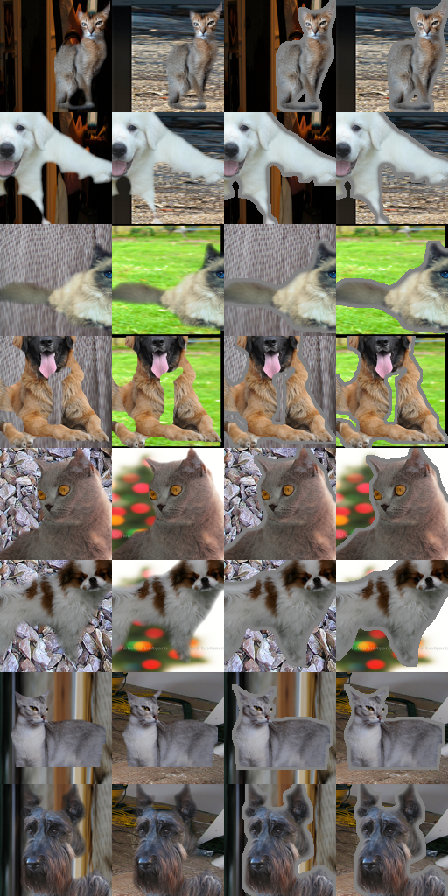

# 背景—尺度联合线索：真实照片最小迁移先导

2026-10-21。**已完成一项真实照片上的CPU机制迁移实验，未取得预设的正向RGB捷径信号。候选保留在参数机制层，不升级为贡献。由于固定读出的前景识别正控较弱，本结果也不能否定更强模型会利用该机制。**

## 实际用了什么

只使用 **Oxford-IIIT Pet** 这一数据集，两个物种标签 Cat/Dog；没有使用受限的 ImageNet/ForNet 原图。64张不同照片来自官方 trainval/test 划分，32张用于拟合、32张留出，前景与背景来源不重叠。每个划分各16个前景来源、16个背景来源。留出再分四个互不重叠的组，每组4个前景、4个背景；**独立单位按来源照片计，不能按生成图数计**。动物身份没有标注，不能声称身份独立。

当前[官方页面](https://www.robots.ox.ac.uk/~vgg/data/pets/)明确标 CC BY-SA 4.0。原始JPEG与无损PNG trimap由公开[同数据集ZIP镜像](https://huggingface.co/datasets/antokun/The-Oxford-IIIT-Pet-Dataset-With-Annotations/tree/003aeb4bc80d584ef307dc24e8b38d26cf9f9e43)按HTTP Range分取，逐项检查大小和CRC。没有下载完整815,141,550字节ZIP，也没有使用Viewer的JPEG掩码显示图。

照片与候选掩码的实际Range响应共 **6,761,595字节**；ZIP目录和小文本另 **3,777,255字节**，另有少量API及官网文本。共读取64张JPEG和128个候选PNG掩码，实际实验使用其中64个掩码。旧归档README写研究用途并要求尊重原网站条款，原文已保留；本轮限定本地非商业科研、不上传或发布。署名与修改说明见 [data-license.md](data-license.md)。

## 检验设计与可见性控制

前景仅取trimap类别1，类别3边界不确定区不作前景；背景从原图类别2区域内取最大矩形，不做生成式补图。背景源类C是原照片宠物物种，**不是场景类别**。按掩码几何规则与固定哈希选样，不使用RGB或模型成绩。背景矩形逐像素核对为原始PNG的类别2。

R_F/R_B取原物体紧框面积除原照片面积，作为尺度程序的数值输入。实现 `T ~ U(0.7 min(R_F,R_B), 1.3 max(R_F,R_B))`，随后做alpha平均值校正、按原长宽比取整缩放、超画布随机裁剪、均匀位置、随机sigma=0.4…4的alpha模糊与阈值变换。无旋转，size_fact=1，软件位图处理。缩放依赖拓扑、后续裁剪/位置/边缘逻辑按原程序实现；CoreGraphics插值和直接可分离高斯不是Pillow逐像素复现。

每个前景与每个“用于决定T的背景来源”交叉，得到320个固定F/T状态。耦合条件实际粘贴该背景；独立对照在**每个相同F/T状态上，穷举本组全部真实背景并等权平均**，所以保持P(F,T)、P(B)、各来源使用权重，有限池内C与F/T独立。没有把构造上独立误称为模型收益。

主布局在最终paste mask外加3像素固定灰色细边带。每个F/T状态的前景RGBA、裁剪、位置、alpha与细边带完全复用；改变背景时，前景和局部边缘RGB逐字节相同，只改变远处背景。这排除了**两条件间前景裁剪、面积或局部对比度改变**的解释，但细边带是额外诊断控制，并非ForAug原始渲染器。普通粘贴布局作为次要检查。

共8704个不同渲染帧、9344条带策略标记的特征记录；部分记录对应同一RGB帧的两种策略归属。仍只有64个来源照片，不能称9344个独立样本。320个F/T状态中227个发生裁剪，零前景状态为0；留出64个状态中42个裁剪。

模型是固定的CPU读出：4×4网格RGB均值与灰度梯度共64维，训练集标准化与固定截断后加平方/交叉项，以类别中心距离形成预测。模型只接收RGB算出的特征，**没有输入T、C、mask或路径**。每个布局分别拟合耦合/独立两个读出，标准化只用耦合训练图；未按留出成绩调参。该模型是弱读出，不是ViT或官方训练复现。

## 真实结果

主要量为耦合训练模型的 `ΔLL = 独立对照损失 − 耦合条件损失`。若模型在新照片上依靠耦合关系获益，预期ΔLL为正。这里主结果不满足：

| 固定读出，留出照片 | 耦合条件 | 独立对照 | ΔLL（nat） |
|---|---:|---:|---:|
| **保护边缘主布局：平均损失** | 0.696193 | 0.693765 | **−0.002428** |
| 同一模型准确率 | 45.31% | 50.00% | — |
| 普通粘贴：平均损失 | 0.692802 | 0.692191 | −0.000611 |
| 同一模型准确率 | 48.44% | 51.95% | — |

主布局四个来源独立留出组的ΔLL依次为 **−0.002574、−0.000447、−0.004070、−0.002621**，没有一组为正。相对独立训练模型的平均差分之差为 **−0.001352 nat**。预先固定的探索性筛查“ΔLL及差分之差在四组均为正”未通过；不是显著性检验，也没有把生成图当独立样本算p值。

背景来源C读出为 **10/16张留出背景正确**，不足以据此声称稳定高于机会水平。固定的灰底前景Y读出为 **30/64个F/T状态正确**；这些状态来自16张留出前景照片。这个正控接近机会水平，说明读出不够强或渲染任务较难，限制了阴性结果的效度。因此：**本轮没有支持可泛化像素捷径的证据，但也没有充分排除该机制。**

主结果之后只补一个明确标为事后的特权参数诊断：给真T/C、按宽0.1分箱，在训练资料拟合简单平滑直方图。相对T-only的留出平均损失收益仅 **0.003453 nat**，四组中两组正、两组负；T/C读出的平均损失约 **0.754523**，还高于恒定0.5预测的0.693147。其耦合→独立损失变化虽为+0.028842 nat，但仅3/4组同号，且输入了图像模型并没有的T/C，**不能把它当RGB捷径证据或拿来替换失败的主结果**。

## 验证、阻碍与当前判断

- 独立Python标准库回读全部192个下载文件的字节数与SHA256，64个实际使用的无损mask另解析PNG CRC/过滤器，背景矩形全部为类别2。
- 32张保存的QA图从PNG像素独立重算64维特征，与Swift记录误差为0；8对保护图的前景/细边带像素完全相同，外部背景确有改变。完整渲染时另执行4352次保护区域哈希一致检查。
- 检查来源/划分不重叠、每个F/T独立对照中C的等权比例、耦合与独立的原背景同图记录一致；保存模型的损失独立回放误差最多5.56×10⁻¹⁶。
- 人工查看多只猫狗接触表，方向与mask对齐可见；这不是对全部掩码或标签保持性的人工认证。
- 软件位图渲染约 **1.98秒**，六个读出拟合/计算约 **2.00秒**（所选Python CPU时间1.99秒）。未安装依赖、启动GPU/A100、使用ARIS、创建账户、上传或修改8A。

为避免把弱读出失败当成机制失败，尝试了一次既有macOS Vision强特征后端的CPU可用性检查：所有可用计算阶段明确选择CPU，在 `qa/case256-neutral.png` 上调用 `VNGenerateImageFeaturePrintRequest` revision2。调用以 **Vision Code 8：“Failed to create CVPixelBufferPool”** 失败，另有IOSurface桥接错误，进程退出133；**没有取得特征**。这属于运行环境失败，不是自动审批拒绝；未提权、重试或改路径绕过。补充强模型没有完成，不能声称验证过。

当前缺口不再是让用户找数据：本项目已有一套可复用的、许可和体积可核查的小样本。若继续同一假设，最低需要一个**在本环境可运行的CPU视觉编码器，并能通过固定前景识别正控**；现有Vision后端失败，新的推理库/预训练权重尚未授权安装或取得，本轮不执行。不要先追加更多合成图、调到留出结果变正或把小子组当成发现。

**决策：保留原参数机制候选，不升级贡献；本次迁移先导没有形成可泛化模型捷径的正证据。它不是ForNet原数据复现，不能声称原论文已被证伪。** 没有正信号就不继续做泛泛查新，也不声称没有完全相同的实验便是创新。

主要证据：`pilot-results.json`、`pilot-verification.json`、`render-receipt.json`、`privileged-parameter-diagnostic.json`、`vision-probe-failure.json`。本地方案记录在 `pilot-protocol.json` 与 `readout-config.json`，在像素/模型结果出现前保存，不宣称外部预注册。`fit_readout.py`、`pets_cpu.swift`、`verify_pilot.py`给出实际执行路径；原结果保留，不原位覆盖。
