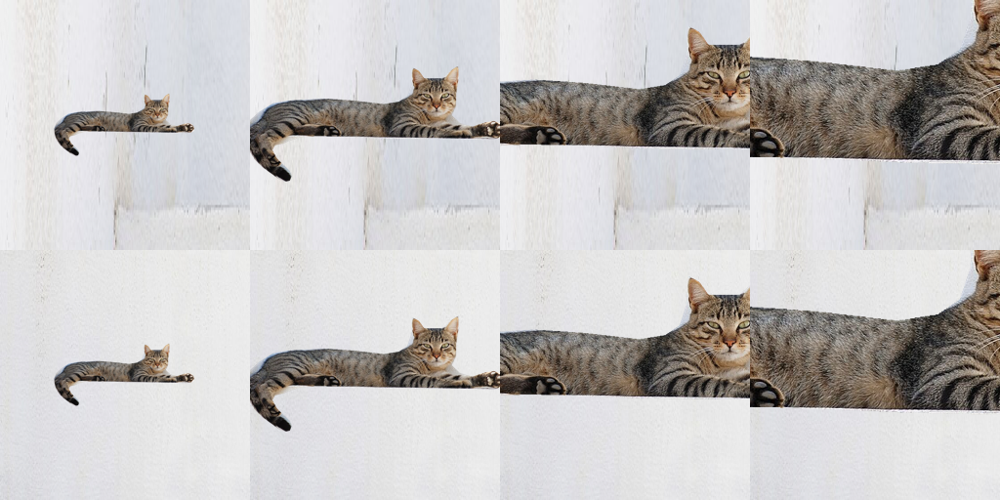

# ForAug 尺度耦合候选：机制与最小像素复核

日期：2026-10-21。保留候选，继续检验其能否形成真实研究贡献。本轮没有换题、使用 ARIS、启动视觉模型训练/GPU、安装软件或下载新照片；没有访问或修改 8A。

**结论：原条件关联符合已知 collider 机制；尺度在一个受控真猫合成例中有 RGB 载体，但尚未验证 ForNet 的背景来源类可从像素辨识，也没有验证模型利用它或产生 OOD 损失。候选仍需真实数据上的关键证据，不能称已成立的贡献。**

## 1. Y、背景来源与 T 的确切关系

固定已有的、源图像不重叠的前景池和背景池后，独立抽取源索引 I、J：

```
(Y, F, R_F) = f(I)
(C, B, R_B) = g(J)          I ⟂ J；U 独立于 I、J
T = 0.7 min(R_F,R_B) + U [1.3 max(R_F,R_B) - 0.7 min(R_F,R_B)]
X = Render(F, B, T, 裁剪/位置/边缘处理等随机性)
```

Y 是新合成图的前景类别，C 是原背景源图中被移除物体的名义 ImageNet 类别，**C 不是已标注的场景类别**。R_F、R_B 仅指官方 `fg_bg_ratios` 的数值输入。函数文档将其描述为前景图总面积相对原图面积（忽略 alpha），不能把它们直接称为最终真实物体 mask 面积。

路径为 `Y ← I → R_F → T ← R_B ← J → C`。I 同时决定标签与比例；这里并不假定生物学上的“标签导致大小”。T 是比例、随机数的共同结果。因此固定 T 后 Y 与 C 出现依赖是预期的 collider 现象，不能称为无条件重新耦合，也不是新因果理论。仅按 J 决定的背景剪枝不会在固定池内破坏独立抽样。

核对源代码：[固定提交的比例与缩放逻辑](https://github.com/tobna/ForAug/blob/fca8765fe8e5c3f99ee8d5e426b87d06b1c817cb/fornet.py#L275)。上述公式适用构造器默认 `range`、jitter=0.3、size_fact=1 的尺度生成分支；不声称复现作者全部训练配置。

已有统计使用 100 个哈希选定来源类、每类 24 个前景（2,400 个）、2,223 个合格背景；背景按图片等概率而非按类别平衡抽样。连续 T 的均匀分布被精确积分进宽 0.1 的 14 个箱，以下统计实际指离散变量 T_bin，而非未经分箱的连续 T。

| 保存张量独立复算 | 结果 |
|---|---:|
| I(Y;C) | 数值误差范围内为 0（绝对值 < 4×10⁻¹⁶ bit） |
| I(Y;C\|T_bin) | 0.00923735 bit |
| I(C;T_bin) | 0.06094036 bit |
| I(C;T_bin\|Y) | 0.07017771 bit |
| 链式恒等式误差 | 5.24×10⁻¹⁶ bit |

恒等式 `I(Y;C|T_bin) = I(Y;C) + I(C;T_bin|Y) − I(C;T_bin)` 成立，与 collider 解释一致。先前置换筛查通过仍是有限元数据池中的探索信号；不能把小数值、置换排序或恒等式包装为真实视觉捷径。若理想预测器同时获得精确 C 与 T_bin，0.00923735 bit 是相对仅获 T_bin 的理想平均对数损失信息增益；它不是准确率提升，更不是实际模型效果。

## 2. 独立比例对照真正改变了什么

再独立抽取 G，从同一背景池取 R_G。只将尺度改为 `T' = φ(R_F,R_G,U)`，实际粘贴的 B 仍来自 J。

- 在源索引生成模型中保持 P(F,T)、P(Y,T)、P(B)、P(F,B)；保存的分箱张量中 P(Y,T_bin) 最大差 3.04×10⁻¹⁸。
- 改变 P(B,T)、P(F,B,T)，通常也改变 P(X)、P(X|Y)，包括背景与对象尺寸、可见性、遮挡以及可能的合成合理性关系。**没有保持逐张视觉内容或视觉质量相同。**
- 原始 P(C,T_bin) 与独立积的总变差为 0.108004；该对照将其降至数值零。对照中的条件互信息为零由构造保证，不是学习算法取得的性能收益。

因此，即使后续观察到分类差异，也需区分背景—尺度联合线索与可见性/难度改变。最简单控制是共用前景、T 清单和背景使用次数，仅重排背景配对；同时报告分辨率、可见 mask 占比、裁剪与前景完整性分层。这样仍是对合成程序的受控比较，不能自动识别自然世界中的因果机制。

## 3. 模型实际能看见什么

[默认数据集返回](https://github.com/tobna/ForAug/blob/fca8765fe8e5c3f99ee8d5e426b87d06b1c817cb/fornet.py#L451)是 RGB 图与训练 target；分类器输入 X，Y 是监督目标，**T 和 C 均没有被直接作为输入特征返回**。可选开启 mask 输出，也不会自动返回 T 或 C。

对象尺度、纹理密度、可见占比可能承载 T 的部分信息；但 alpha 校正、整数量化、裁剪、模糊、后续图像变换会使 T 与最终可见占比不同。C 来自已移除的原对象，背景是否还保留可辨识的 C 信息，需要另测；仅知道来源目录名不等于像素中存在该线索。

## 4. 本轮真实像素检查：正例与失效边界同时保留

复用 Alvesgaspar 的 CC BY-SA 3.0 真猫照片（960×587，128,428 字节，许可见 [image-credits.md](image-credits.md)），人工粗轮廓与同图两块明亮背景裁剪。使用已安装 Swift/macOS CoreGraphics 软件位图，生成 28 张 256×256 合成图。按尺度与 alpha 校正计算目标宽高、超画布居中裁剪、居中粘贴；没有重放完整 ForAug 训练分支，插值也非 Pillow 逐像素复现。

预先保存的本地 protocol 固定：背景0的 T=0.03/0.07/0.11/0.15 四点用于最小线性校准，背景1的 T=0.05/0.09/0.13/0.17 四点留出。特征只有 RGB 亮度<128的像素比例，校准后不调整阈值或拟合区间。另有六个大尺度裁剪探针。这里的“留出”仍是同一只猫、同一原照片的另一个白背景裁剪，**不是跨对象或独立自然场景泛化**。

| 检查 | 实测结果与范围 |
|---|---|
| 图像可读的低尺度线索 | 四个留出点 T 预测 MAE=0.00071844，最大绝对误差=0.00151736；仅说明本受控单猫例可读 |
| 未裁剪的可见 alpha 占比 | 14张最大 \|A−T\|=0.00140035；A 是合成 mask oracle，非默认模型输入 |
| 大尺度裁剪探针 | 六点沿用原校准 MAE=0.31475551；包括拟合范围外推，不能把失败全部归因于裁剪 |
| T=0.50 | 最终可见 A=0.301677；RGB 暗像素校准估计 T=0.306674 |
| T=1.20 | 最终可见 A=0.426211；RGB 暗像素校准估计 T=0.456675 |

T=1.20 并不意味着最终物体占画布120%；裁剪和处理后只剩约42.62%的加权 alpha 面积。结果排除了“把 T 直接当最终可见面积”的解读，但**未证明所有图像预测器都不能反推出 T**。接触表中大尺度猫头/身体被截断，也没有进行标签保持率或模型识别率评估。



生成图经人工查看：方向正确，猫轮廓保留，粗边包含少量台阶；两背景裁剪视觉上无猫。Python标准库独立解析全部28个PNG的CRC、压缩流和行过滤器，从保存RGB重算暗像素比例，与渲染时记录差为0；独立回读前景alpha占比一致。首次核验中“两个明亮背景应恰无暗像素”的断言失败：背景0有1/65536暗像素。已删除这个无依据假设并记录实测基线，未改图像、拟合分工或结果。

## 5. 候选状态和最短下一关

这次补上了一个**真实照片上的合成尺度到RGB传导检查**，并没有补上 ForNet 中 C 的图像可辨识性。因此候选仍是“程序/来源参数层信号，加上单图像素载体演示”，不是完整的真实 CV 证据，也未形成原创贡献。

继续保留的可证伪问题是：**当对象尺度可见时，实际移除对象后的背景像素是否还携带额外标签信息，且这种联合信息是否能被分类器利用，而不是可见性改变造成？** 若真实背景中 C 不可读，或固定尺度/可见性后的联合线索增益消失，应削弱或否定该机制解释，不能仅凭前面的正条件互信息继续声称有害捷径。

当前具体缺口：本轮只复用一张已许可猫照片，没有实际 ForNet 配对图像；无法检验100类来源信号的像素载体。下一项最低有效证据应是源图不重叠的真实 ForNet 前景/背景小样本、固定 T 的配对重排和图像特征读出；先做CPU读出和可见性审核，不需要大模型训练。真正获取该样本前，必须先明确官方下载单位、可分取的字节数、图像许可范围与最小下载预算。本轮没有执行新图像下载或依赖安装。

本轮尝试通过网页工具读取固定 ForNet revision 的官方文件树API，仅返回工具不可访问的 Internal Error；没有拿到新的精确文件大小。这是元数据读取未成功，不是已确认仓库不存在，也没有执行下载。没有为此改用受限路径或绕过先前拒绝。

最近工作覆盖沿用上一轮 `candidate-check.json` 中已完成的16个定向查询；本轮不重复泛搜。ForAug已经讨论联合分布、大小偏差，collider现象也已知；本轮不能据此保证新颖性。目标仍是找到经过真实证据支持的研究亮点，课堂讲解不替代这项检验。

## 文件与复核

- `protocol.md`：渲染前保存的本地方案，不宣称外部预注册。
- `pixel_check.swift`：软件位图合成源码；`source-cat.jpg`：逐字节保留原缩略图。
- `pixel-raw-results.json`、`mask-and-crops.json`：原始像素统计、轮廓、尺寸与裁剪。
- `pixel-results.json`、`mechanism-results.json`：独立数值汇总与链式恒等式/对照检查。
- `pixel-verification.json`：保存PNG独立读回、首次断言修正记录、哈希与限制。
- `verify_substance.py --check`：只读复核本目录结果，读取上一级已有 `scale-range-joint.json`，不覆盖结果、不联网。

执行环境为 Mac 既有 Python 标准库、Swift 6.4 和系统图像框架。渲染记录约0.152秒，不包含编译与文件验证时间。没有新增研究子智能体或重新做模型档位审计；不将模型请求参数当作实际运行回执。
